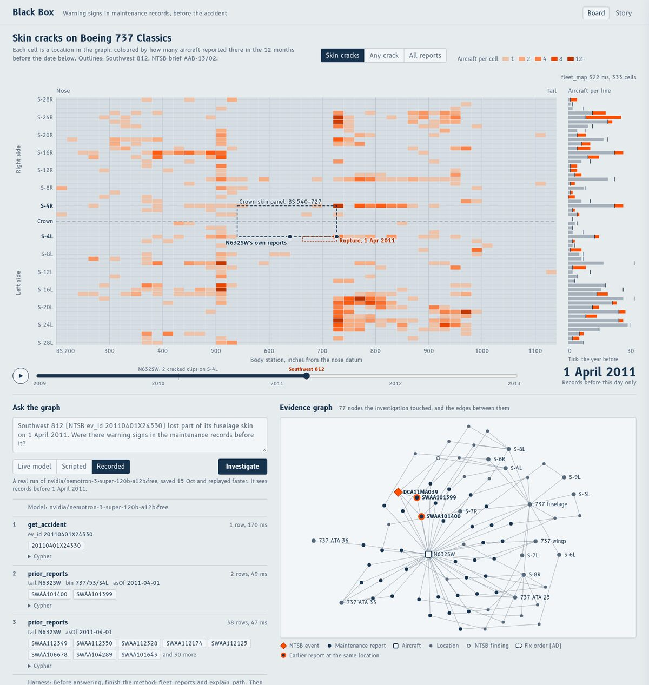
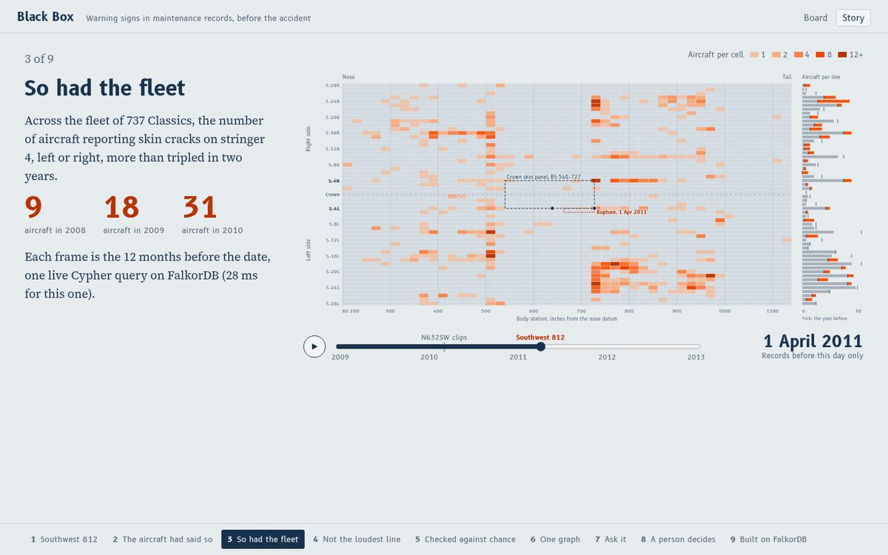
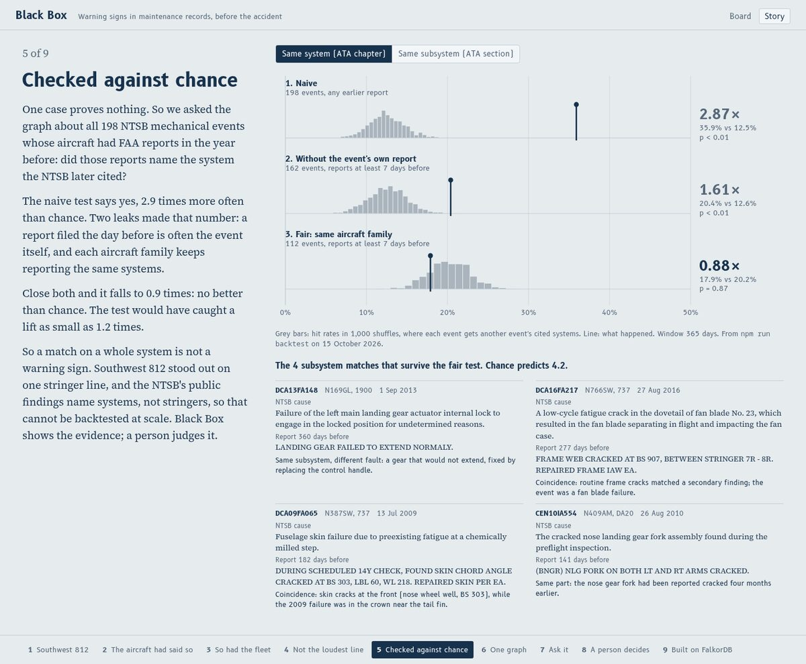
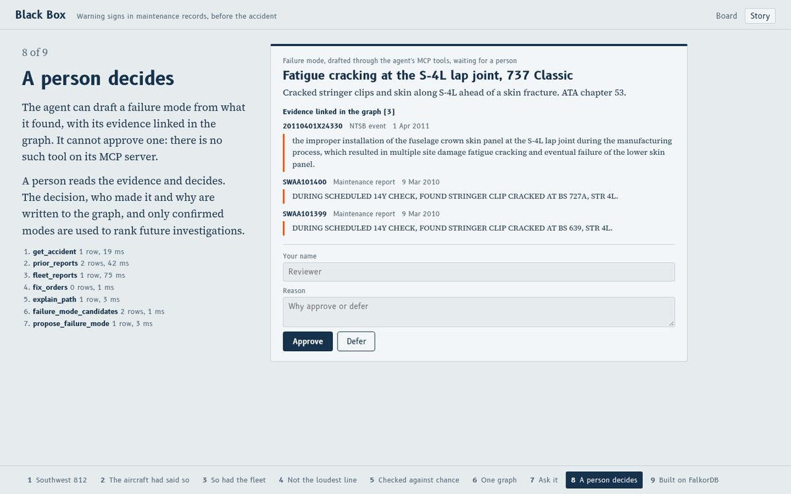

# Black Box

**Warning signs in maintenance records, before the accident.**

Black Box joins public NTSB accident data and FAA maintenance reports in one FalkorDB graph,
so an investigator (or an agent) can ask: before this accident, did the aircraft or its fleet
report trouble at that spot?



**Framing rule: Black Box shows warning signs and leads worth review, never causes. The NTSB
determines causes.** Scope: mechanical and structural events. Pilot error and weather are out of scope.

Graph Hacks (FalkorDB × WeMakeDevs), Oct 15–18 2026. Tracks: **1. Agents That Act** (main),
2. Memory & Coordination, 3. Company Brain (thin, see [Limits](#limits)).

## What it does

- **Board** (`/`): an unrolled Boeing 737 fuselage. Each cell is a location in the graph
  (stringer line × 20-inch body-station bin), coloured by how many aircraft reported cracks
  there in the 12 months before the slider date. Drag or play the date; click a cell to read
  the reports behind it.
- **Agent**: ask a question in plain English. The model picks tools on our MCP server, each a
  fixed Cypher query. Every call appears with its arguments, Cypher, rows and time, and the
  records it touched join an evidence graph.
- **Human approval**: the agent can draft a failure mode with its evidence linked in the graph.
  Only a person can approve, defer or reopen it, and the decision, who made it and why are
  stored on the node. The agent has no approve tool.
- **Story** (`/story`): a nine-step presentation where every number and picture is a live
  query, apart from the saved evaluation run below.

## The case: Southwest 812

On 1 April 2011 a 737-300, N632SW, lost a 60 × 8 inch section of crown skin at 34,000 feet.
The NTSB found fatigue cracking along the S-4L lap joint from a panel installed improperly
during manufacture (brief AAB-13/02). What the graph shows before that date:

- **The aircraft:** on 9 March 2010 mechanics found two cracked stringer clips on S-4L
  (SWAA101399 at BS 639, SWAA101400 at BS 727A), 24 inches ahead of the later rupture and at its aft edge.
- **The fleet:** the number of 737 Classics reporting skin cracks on S-4L or S-4R went 9 → 18 → 31
  aircraft in 2008, 2009 and 2010.
- **Not the loudest line:** by raw counts, lower lines (S-24, S-18) had more. Ranked by rise
  (aircraft this year vs last), S-4L was 2nd of 37 lines on 1 January 2011 (17 aircraft, up from 7).
  A rising line is a lead worth review, not a prediction.



## Does it generalise? We checked, and the simple version does not

One case proves nothing, so `services/eval/src/backtest.ts` asks the graph about every NTSB
mechanical event whose aircraft had FAA reports in the year before: did those reports name a
system (ATA chapter) the NTSB later cited? Chance is measured by a permutation test: each event
gets another event's cited systems, 1,000 seeded shuffles, so each aircraft keeps its own report volume.

| Test (365-day window, system level) | Events | Hit rate | Chance | Lift | p |
|---|---|---|---|---|---|
| 1. Naive: any earlier report, chance from any event | 198 | 35.9% | 12.5% | 2.87× | < 0.01 |
| 2. Reports at least 7 days before (drops the event's own report) | 162 | 20.4% | 12.6% | 1.61× | < 0.01 |
| 3. Chance from the same aircraft family only | 112 | 17.9% | 20.2% | **0.88×** | 0.87 |

Each step closes one leak. A report filed the day before is often the event itself, and each
aircraft family keeps reporting the same systems (helicopter accidents cite rotors, and helicopters
report rotors). With both closed, **one aircraft's history does not beat chance**, and the test
would have caught a lift as small as 1.19×. The result holds for a 730-day window (1.06×, p = 0.33),
gaps of 1 to 30 days (0.87–0.91×) and the stricter ATA-section match (0.94×).

What this means for the product: a match on a whole system is not a warning sign. What made
Southwest 812 stand out was one stringer line and a rise across the fleet. The NTSB's public
findings name systems, never stringers, so that cannot be backtested at scale from public records.
That is why Black Box shows evidence and leaves the judgement to a person.

```bash
npm run backtest -w services/eval -- --days=365 --gap=7 --out=$PWD/apps/web/public/backtest.json
```



## How it works

### Graph model (one graph, `blackbox`)

| Node | Count | From |
|---|---|---|
| `Report` | 225,627 | FAA Service Difficulty Reports 2008–2026: every 737 structures report (ATA 52–57) plus every report on an aircraft in an NTSB event |
| `Accident` | 4,235 | NTSB mechanical events 2008–2020 (a cause or factor finding in aircraft systems, structures, propeller/rotor or power plant) |
| `Finding` | 5,386 | NTSB findings; the finding code carries the ATA chapter and section |
| `Aircraft`, `Model` | 7,548, 1,148 | by tail and serial number; model family and variant |
| `Location` | 8,483 | hierarchy: model + ATA chapter (zone) → stringer line → 20-inch body-station bin |
| `System` | 46 | ATA chapters |
| `FixOrder` | 2 | AD 2011-08-51, superseded by AD 2015-16-08 |
| `FailureMode` | 4 | 3 seeded, 1 drafted by the agent and waiting for a person |

```
(Report)-[:ON]->(Aircraft)<-[:INVOLVED]-(Accident)-[:FOUND]->(Finding)
(Report)-[:AT]->(Location)-[:WITHIN]->(Location)        bin -> line -> zone
(Finding)-[:AT]->(Location)   (Location|Finding)-[:IN_SYSTEM]->(System)   (Aircraft)-[:IS_A]->(Model)
(FixOrder)-[:TARGETS]->(Location)   (FixOrder)-[:SUPERSEDES]->(FixOrder)
written by the agent:  (Report)-[:PRECURSOR_OF]->(Accident)   (Report|Accident)-[:EVIDENCE_FOR]->(FailureMode)
```

The two sources were never meant to be read together. They meet at the aircraft (tail and
serial) and at the location, so "reports on stringer S-4L" rolls up every bin along it:

```cypher
MATCH (r:Report)-[:AT]->(:Location)-[:WITHIN*0..2]->(:Location {bin: $bin})
WHERE r.date < $asOf AND r.date >= toString(date($asOf) - duration({days: $windowDays}))
```

FalkorDB features in use: variable-length paths over the location hierarchy, `algo.SPpaths` for
the shortest evidence path between a report and an accident (all shortest paths, keeping one that
only passes through records before the investigation date), the full-text index on report text,
date and duration functions for the time machine, and `UNION ALL` typed counts for the schema view.
View queries run in tens of milliseconds; the heaviest (`fleet_map`, cold) takes about 0.3 s.
All Cypher lives in `packages/graph/queries/cypher.ts`.

**A FalkorDB bug we hit (v4.14.6):** with a range index on a string property, `r.date < '2011-04-01'`
matched every row (1,000 instead of 198 in our repro). We dropped the date indexes and recomputed every number.

### MCP server and agent

- `packages/mcp-server`: 20 domain tools, each a fixed Cypher query with typed arguments.
  Read tools include `get_accident`, `prior_reports`, `fleet_reports`, `explain_path` and
  `similar_reports`; write tools include `record_precursor` and `propose_failure_mode`.
  There is no approve tool.
- `packages/agent`: a tool-calling loop over that MCP server, on OpenRouter. Default model
  NVIDIA Nemotron 3 Super (free tier), with two free fallbacks. The harness clamps every date
  argument to the investigation date, so the model cannot read past it. Two guard rails for
  smaller models: if it answers before checking the fleet and the evidence path, it is asked
  once to finish; if the answer claims a cause, it is asked once to rewrite.
- The UI has three modes: **Live model** (needs a key; free models take minutes), **Scripted**
  (the same tools in a fixed order, no model) and **Recorded** (a real 297-second Nemotron run,
  replayed in about 20 seconds; the default for demos).
- Approval goes through `/api/decide`, a UI-only route the agent cannot reach.



## Run it

Needs Docker and Node (tested on Node 26); the data download also needs curl, unzip and
[uv](https://docs.astral.sh/uv/).

```bash
git clone https://github.com/divyam2356/GraphsHackathon && cd GraphsHackathon
docker compose up -d          # FalkorDB v4.14.6 on :6379, FalkorDB Browser on :3000
cp .env.example .env          # optional: OPENROUTER_API_KEY for the live agent
npm ci
scripts/fetch-data.sh         # public NTSB + FAA files into data/raw (~700 MB)
npm run graph:indexes
npm run ingest:ntsb           # 4,235 events (~10 s)
npm run ingest:reports        # 225,627 reports (~35 s, ~600 MB in FalkorDB)
npm run ingest:fixorders && npm run seed:modes && npm run org:gen
npm run dev                   # http://localhost:3001 (Board) and /story
npm run backtest -w services/eval
```

Without a key everything runs except the Live model mode. `DEMO=1` serves a tiny offline
SWA 812 fixture instead of FalkorDB; it is off by default and never used for the numbers here.

## Limits

- **No per-aircraft signal at the system level** (the backtest above). The Southwest 812 signal is
  location-level and fleet-level, shown for one case; it is not validated across events.
- **Leads ranking is mechanics, not evidence.** `rank_failure_modes` scores confirmed
  modes from the graph (family and ATA chapter match, signature-line overlap with the
  aircraft's earlier reports, full-text similarity), and only modes known before the
  investigation date take part. For Southwest 812 that is none: the crown S-4L mode only
  became known with AD 2011-08-51 on 5 April 2011, so the honest answer is "no known mode,
  draft a new one for a person" (Story step 8). With 2 confirmed modes it is not evaluated.
- `similar_reports` uses the full-text index; no embeddings are loaded.
- Fix orders: the two S-4L ADs only. Company layer (Track 3): 3 teams, 15 engineers, 2 task cards
  and 1 decision, all `synthetic: true`, reachable through the `who_fixed`, `why_task` and `stale_tasks` tools.
- The hotspot job's `algo.labelPropagation` over same-bin edges reduces to grouping by bin.
- Free OpenRouter models: 50 requests a day; a full run uses about 10 and takes about 5 minutes.

## Repo map

```
apps/web/               Next.js UI: Board (/), Story (/story), API routes (agent, view, decide)
packages/graph/         FalkorDB client, all Cypher (queries/cypher.ts), indexes, schema
packages/mcp-server/    MCP server: the only way the agent touches the graph
packages/agent/         Agent loop on OpenRouter (agent.ts), recorder (record.ts), CLI flows
services/ingest/        NTSB, FAA reports, fix orders, seed failure modes
services/eval/          backtest.ts (the evaluation), all.ts (SWA 812 regression checks)
services/org-generator/ Northwind Aero, the fictional maintenance company (synthetic: true)
docs/                   GRAPH_MODEL, FLOWS (the original plan), DEFENSE, DEMO
ROADMAP.md              decisions, pending decisions and the plan to the deadline
```

## Data and licences

NTSB aviation accident database (avall) and FAA Service Difficulty Reports: US government
public data. NTSB brief AAB-13/02 and the Federal Register AD texts were used to check facts.
No private or scraped data.

## AI disclosure

Built with AI coding assistants (Claude Code, OpenCode). The agent in the app runs on NVIDIA
Nemotron 3 Super through OpenRouter's free tier. The team chose the problem, the framing rule
and the scope; failure-mode approvals in the app are made by a person.
